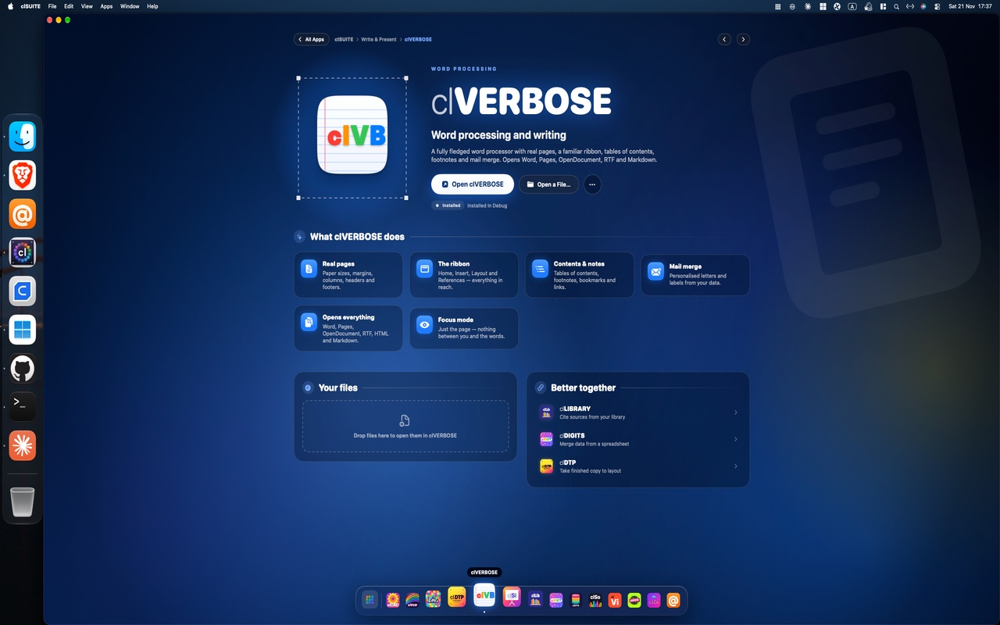
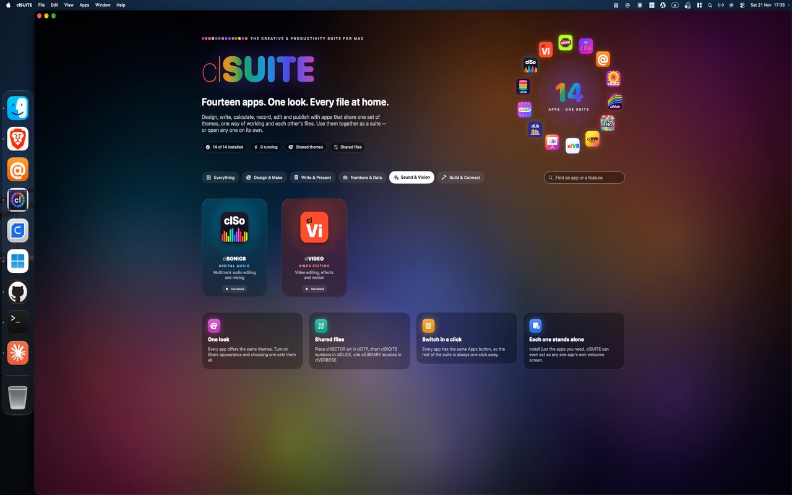
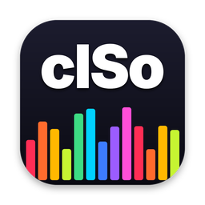
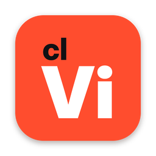
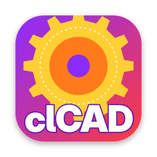

# clSUITE

Welcome to the cyberlizard Suite launcher.  This is a one stop shop that displays all of the applications from the suite that you have installed in your applications folder.  You can run it from the dock or from the menu bar, or not at all, the choice is yours.  For added cuteness the launcher has its own mini-dock which you will see in the images.

Like every app in this suite, everything is written in Swift and so file sizes are tiny and speed is optimised.  Personally, life is better with pictures rather than text so do not let me stand in the way of progress.

### Welcome to the launcher

### the mini launcher

### the mini dock

### build and connect

### design and make

### numbers and data

### sound and vision

### write and present

who or what is cyberlizard?  

my name is Steve.  My regular job is an overworked and underpaid psychiatric nurse in the NHS working for the NHS, mostly on acute mental health wards caring for some of societies most unwell people.  Before taking up this career, I was a computer tinkerer, from Z80s right up until now.  After years of fighting with Windows, but not being able to gel with Linux, I took the plunge and moved over the Apple computers and am slowly getting used to the way things are, but sometimes you just cannot find the apps you want.  When the app does not exist as you like it there is only one solution and that is to create it.  Cyberlizard is just my regular internet username and so I took the 'c' and the 'l' as the prefix for my apps.  So what is in this suite of apps.  Here is the list:

### clSonic Brings a fully fledged digital audio workstation to your Mac.  Whether the audio is analog, stereo or 5.1, digital / MIDI, or you just need to create some notation software, this app is for you. 

### clVideo is a non-linear video editing solution that blends elements of well known editors with the simplicity of iMovie coupled to After Effects style manipulation via keyframes

### clCAD - need to design a 3d model?  Want to use a CNC machine to create your part?  Want to create something for a LASER cutter.  This app does it all and more:  2d geometry, 3d part design, CNC tooling, load deformation and visualisation.  It's all here in a user friendly form.

