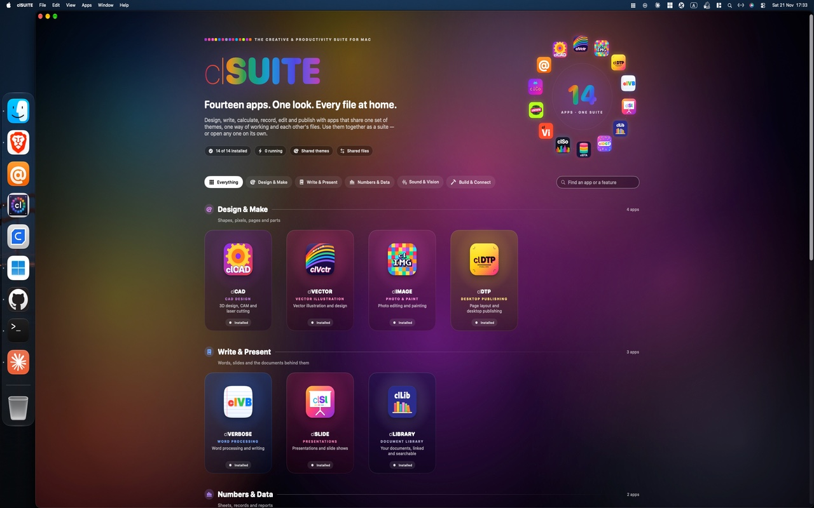
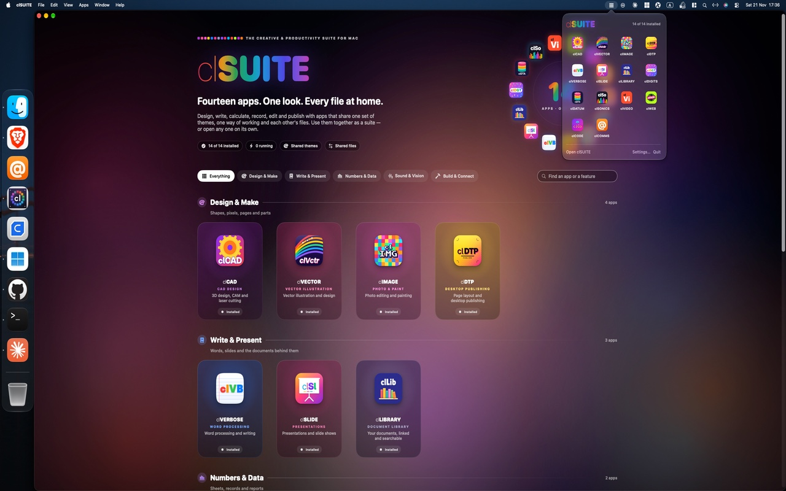
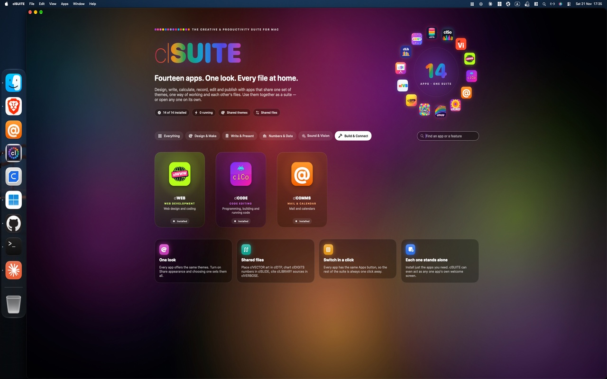
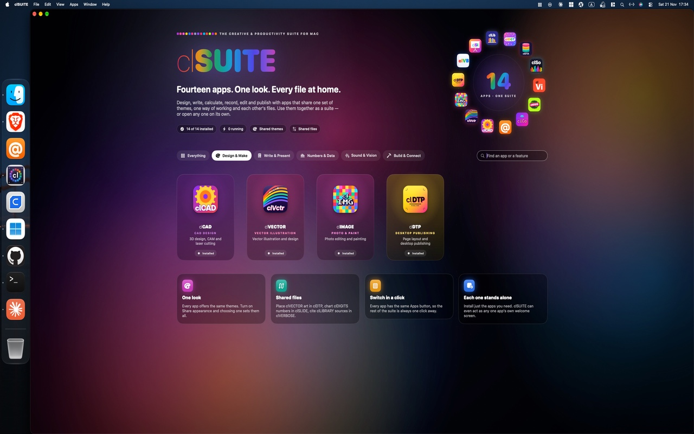
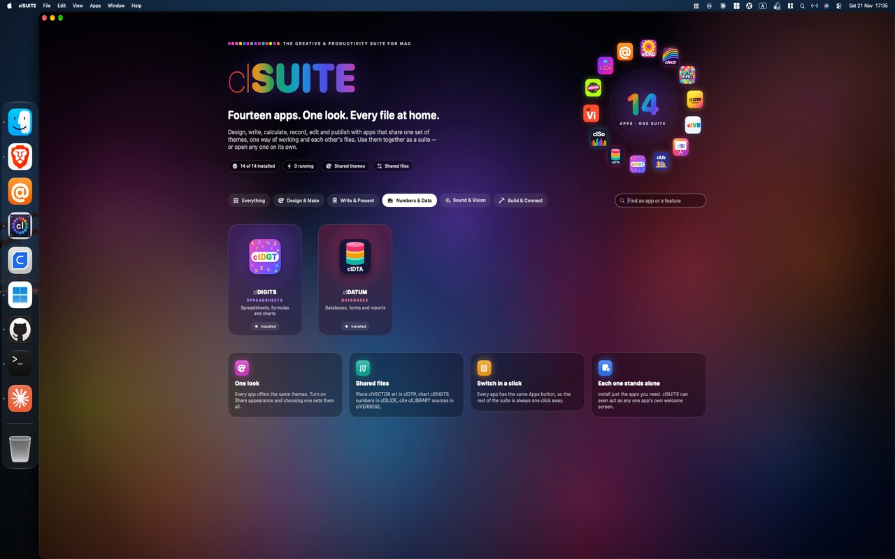
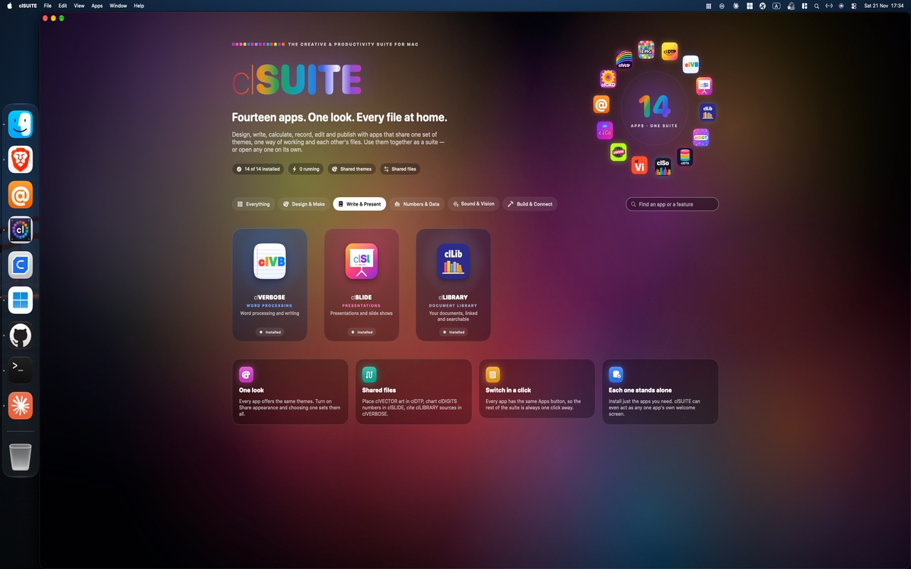

# clSUITE

Welcome to the cyberlizard Suite launcher.  This is a one stop shop that displays all of the applications from the suite that you have installed in your applications folder.  You can run it from the dock or from the menu bar, or not at all, the choice is yours.  For added cuteness the launcher has its own mini-dock which you will see in the images.

Like every app in this suite, everything is written in Swift and so file sizes are tiny and speed is optimised.  Personally, life is better with pictures rather than text so do not let me stand in the way of progress.

### Welcome to the launcher

### the mini launcher

### the mini dock

### build and connect

### design and make

### numbers and data

### sound and vision

### write and present

